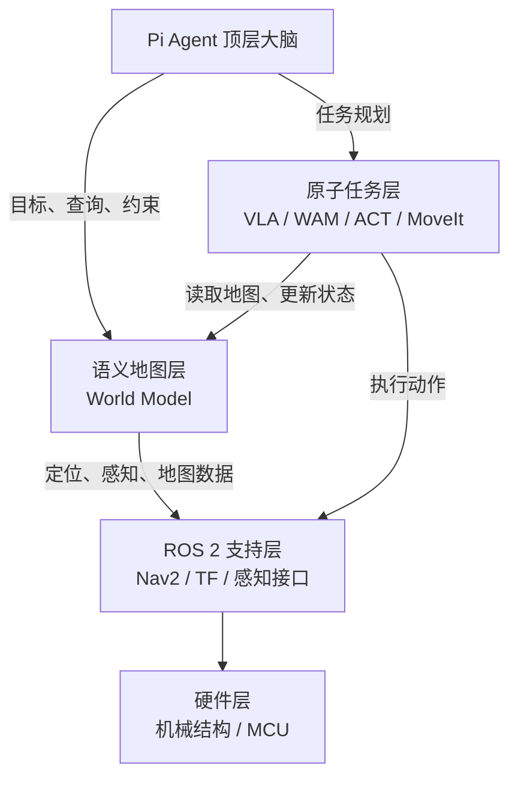

# 本会话总结：机器人整体架构与语义地图层

- 总结时间：2026-11-12 16:43（北京时间）
- 文档性质：本次会话讨论总结
- 相关目录规则：参照同目录 `README.md`，文件名附时间戳。

## 一、用户的机器人分层设想

机器人计划分为五层：

1. **Agent 层**：使用 Pi Agent 作为顶层大脑，负责理解目标、规划和调用能力。
2. **原子任务层**：使用 VLA、WAM、ACT、MoveIt 等形成可组合的原子任务和工具集。
3. **语义地图层**：维护房间、物体、空间关系、状态和历史，为 Agent 与原子任务提供世界模型。
4. **ROS 2 支持层**：负责中间件、Nav2、TF、感知接口及其他机器人软件基础设施。
5. **硬件层**：包括机械结构、执行器和高实时 MCU 固件。

推荐的依赖关系是：



## 二、语义地图层的职责

语义地图层应作为独立的世界模型服务，负责：

- 空间：楼层、房间、区域、门、走廊及其几何边界。
- 对象：物体类别、实例、位置、姿态和属性。
- 关系：物体位于房间、物体在桌上、房间连接走廊等关系。
- 状态：存在性、可抓取性、占用状态、最近观察时间和置信度。
- 历史：物体移动记录、观察来源、地图版本和变化记录。

Agent 和原子任务不应直接读取点云或 ROS topic，而应调用稳定的语义接口，例如：

```text
find_object("红色工具箱")
get_room("厨房")
list_objects(room="仓库", type="箱子")
is_reachable(object_id)
get_object_history(object_id)
observe_and_update(area)
```

## 三、ConceptGraphs 与 Kimera 的定位

此前讨论结论已修正为：**ConceptGraphs 和 Kimera 本身也是模块化框架，不是不可拆分的大世界模型，应该纳入候选方案，而不只是作为参考文献。**

- **Kimera**：偏视觉惯性定位、SLAM、3D 网格和语义建图。
- **ConceptGraphs**：偏开放词汇对象识别、对象级 3D 语义关系和场景查询。
- 二者可以作为语义地图层的内部组件，再由自建 World Model 补充长期状态、历史、版本和对外 API。

更准确的组合方式是：

```text
Kimera / RTAB-Map：定位、几何地图、空间重建
ConceptGraphs 或同类感知链：对象语义与空间关系
World Model：房间、对象、状态、历史、版本
ROS 2 / Nav2：实时运行、导航和设备集成
```

## 四、建议的技术分工

| 能力 | 候选技术 |
|---|---|
| 定位与几何建图 | Kimera、RTAB-Map、SLAM Toolbox |
| 导航与可达性 | ROS 2、Nav2、TF2 |
| 3D 占据空间 | OctoMap、Voxblox 等 |
| 固定类别检测 | YOLO |
| 开放词汇检测 | Grounding DINO 等 |
| 实例分割 | SAM 2 等 |
| 对象身份确认 | Re-ID、AprilTag、RFID、UWB |
| 空间数据 | PostgreSQL + PostGIS |
| 语义关系 | Neo4j 或关系数据库 |
| 任务执行 | MoveIt、行为树、原子技能 |

工业系统通常会复用这些成熟算法和框架，再增加统一接口、数据模型、容错、监控、地图持久化和长期运行能力。模块化不一定自动更稳定，稳定性依赖于接口和数据一致性设计。

需要统一：

- 坐标系和 TF 约定；
- 对象 ID；
- 时间戳；
- 置信度；
- 地图版本；
- 更新和冲突处理接口。

## 五、房间用途与物品跟踪

房间用途建议支持三种来源，优先级为：

```text
用户指定 > 系统推断 > 未知
```

自动推断应先作为候选标签保存，经过用户确认后再成为正式标签。

物品能力需要区分：

- **识别有什么**：检测、分割、3D 投影可以完成。
- **确认是不是同一个物品**：需要 Re-ID、外观特征或 AprilTag、RFID、UWB 等身份手段。

仅靠视觉类别检测通常只能知道“这里有一个箱子”，不能可靠证明“这是上次看到的同一个箱子”。

## 六、推荐的设计顺序

从机器人整体需求出发，而不是先单独比较某个语义建图项目：

```text
机器人任务
  ↓
语义地图需要提供的查询和动作
  ↓
地图数据模型与接口
  ↓
感知、定位、建图组件选型
  ↓
ROS 2 集成与运行时设计
```

下一步应先形成一份语义地图层的需求和接口草案，再根据传感器配置、实时性、物体跟踪要求和长期运行目标选择 Kimera、ConceptGraphs、RTAB-Map 等具体组件。

## 七、当前阶段结论

1. 机器人整体分层方向合理。
2. 语义地图层应是独立的 World Model 服务，连接 Agent、原子任务层和 ROS 2。
3. ConceptGraphs 和 Kimera 值得直接研究和复用，不应被简单归类为“仅供参考”。
4. 具体技术选型要由整体任务、传感器、实时性和长期运行要求反推。
5. 工业落地通常采用成熟组件组合，并用统一接口和数据模型把它们集成为完整系统。
