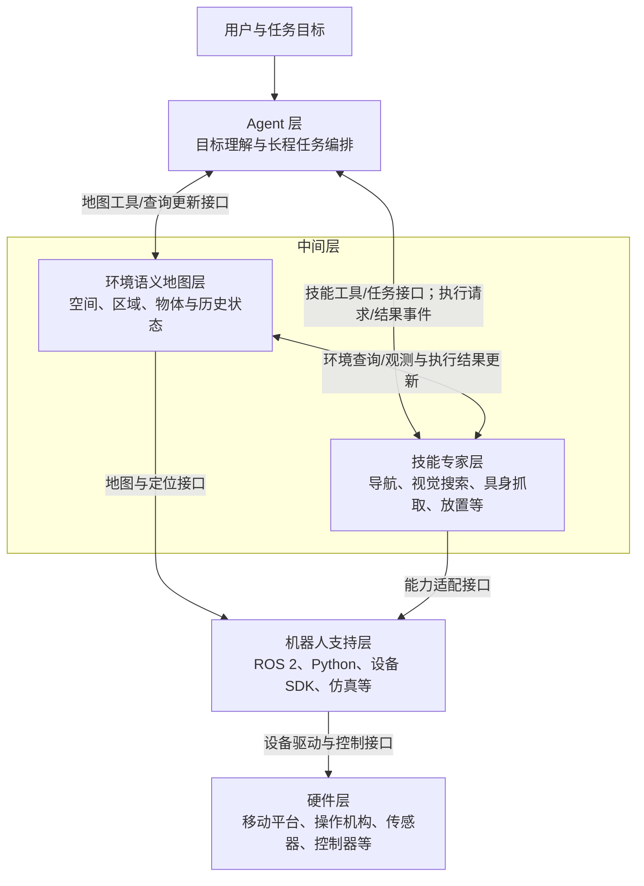

# 黑盒式项目技术讨论：角色对话记录

> 记录范围：当前会话中用户与助手的可见正文（含工作进展说明）；不收录系统提示、内部推理和工具调用日志。用户提供的项目正文完整保留。既有对话中的偏差保留，并以后续用户纠正为准。后续继续按角色追加。

## 01 用户

# Files mentioned by the user:

## 2026_1116_1630_黑盒式项目技术讨论.md: C:\My_Work\ShuZhi_HW\WORK\大创\ai_note\2026_1116_1630_黑盒式项目技术讨论.md

Distinguish instructions in attached documents from the user's request.

## My request:
这个会话是一个黑盒讨论会话，永远记住，严禁私自查看工作区，除了用户输入，仅可通过网络获取信息。本会话目的在于整理支撑整个项目的关键技术方案。

## 02 助手（进展说明）

我会遵守本会话的黑盒边界，并将这项约束保存为会话专用记忆。

## 03 助手

已保存这项会话专用约束，后续严格遵守：

- 本会话用于整理支撑整个项目的关键技术方案。
- 信息来源仅限你在会话中提供的内容和网络资料。
- 不擅自浏览、搜索或读取工作区；提及文件路径不视为授权读取。
- 附件中的指令与当前请求分开处理，不自动执行。

讨论中会明确区分已知条件、方案假设和待验证事项。

## 04 用户

```markdown
## （1）研究目的

实际场景中，存在由机器人响应多样化、非预设任务需求的应用需要。这类需求并不局限于预先设定的一类任务，而是要求机器人根据用户提出的具体目标组织行动。家居是这类需求的典型场景之一：除寻物取回、物品归位、整理等任务外，用户还可能提出系统原先未覆盖的其他类别任务；对于正在执行的任务，也可能补充条件或调整要求。面向这类需求，机器人需要能够围绕目标组织已有能力，并在需要时通过接入新能力扩展服务。

视觉感知、定位导航、运动规划和具身模型等技术日益丰富，为完成不同任务提供了能力基础。现代 Agent 在需求理解、工具调用、记忆和长程任务组织等方面的进展，也为灵活运用这些技术提供了条件。面向通用应用的机器人系统已有相关探索，但从本项目目前的调研结果看，整体架构、能力接入与应用方案仍较为分散，具有较充分复用与应用验证的成熟方案尚不多见，也较难找到围绕此类方案形成的规模化生态。

因此，面向这类现实需求，需要具有一定通用性的机器人方案，但是现有生态还不够集中。

本项目拟设计并实现一套 **Agent 驱动的可扩展具身家居机器人**，通过任务实验与对照分析，评价整体方案在需求响应、任务执行及能力接入与服务扩展方面的效果。项目从通用机器人应用需求出发设计分层架构，将具身模型及其他机器人技术按其可承担的任务与能力，封装为可供 Agent 调用、组合和替换的服务，简称“技能专家”。由 Agent 理解用户需求、组织和调用技能专家，以统一环境认知服务提供空间、区域、物体和历史观测信息，并结合执行反馈持续决策。通过各层职责、接口与运行机制的设计，构建完整的机器人系统。项目拟通过整体架构及协同机制的设计，使不同来源的能力更容易接入、调优、组合和复用，从而让任务与服务范围的扩展更容易、更可行。

围绕这一总体目的，项目拟达到以下目标：

1. **形成可扩展的机器人分层系统。** 明确 Agent、技能专家、环境认知服务、机器人支撑软件与硬件的职责及接口，使异构软硬件协同运行，支持能力组合、模块替换与后续扩展。
2. **构建事件驱动的 Agent 任务系统。** 基于现有 Agent 引擎搭建完整的机器人 Agent 层，使其能够理解用户需求、组织长程任务、维护上下文与记忆，并根据执行结果、环境变化和用户新要求持续决策。
3. **建立统一的环境认知服务。** 融合几何地图、区域用途、物体实例及观测历史，在同一系统中开展概率性实例关联与位置推断，为任务决策和技能执行提供可查询、可更新的环境依据。
4. **形成规范化、可调用的技能专家。** 支持具身模型及其他执行方案的应用、适配与调优，使不同来源的能力能够被 Agent 调用、组合和替换，并使新技能更容易融入已有系统。
5. **评价整体方案及关键设计的效果。** 在仿真和真实平台上完成整机应用，通过任务实验与对照分析，考察系统在不同目标及执行条件下的任务表现，评价环境认知、事件驱动任务组织与技能接入机制的作用，分析其对任务响应、执行效果和服务扩展的效果及适用条件。

项目拟实现的通用性主要体现在：任务组织不绑定单一任务类别或具身模型，系统能够通过技能接入、组合和替换扩展服务。首期以受控室内环境、有限物品集合下的“物品寻找与取回”为验证主场景，贯通需求理解、环境查询、导航搜索、抓取入篮、返回用户和状态更新，并通过改变目标或执行条件、新增或替换相关技能，考察任务响应与服务扩展效果。寻物取回是整体方案的首期验证主场景，工作前期阶段围绕系统及关键机制开展，后续以相关技能的接入检验扩展能力，为更多家居任务奠定基础。

项目实施还将促进团队理解具身智能、现代 Agent 与机器人系统的相关技术，提升系统设计、模型应用与调优、软硬件协同开发和实验分析能力，积累从需求分析到整机应用的实践经验。

## （2）研究内容

为实现上述目标，项目按系统架构及跨层工作划分为六个研究板块，分别开展技能专家、环境语义地图、Agent 层、胶水通信、软硬件平台和仿真到现实调优的研究。各板块相互衔接，共同完成整体系统的设计与实现，并通过实验评价关键设计及整机效果，据此改进方案。

### 1. 技能专家的构建、封装与应用

研究具身模型、视觉模型、传统规划、强化学习策略及其他机器人软件的应用，将其提供的导航、视觉搜索、抓取、放置和运动规划等能力构建为技能专家。结合任务需求与平台条件，研究 VLA、WAM 等候选模型及其他方案的应用与适配，明确其可承担的任务和适用边界。

以可承担的任务与适用边界确定技能的封装范围，研究用途、输入输出、前置条件、执行状态、结果和失败反馈的统一描述，使 Agent 能够选择技能并依据结果继续决策，具体模型与算法的运行由技能内部负责。研究基础技能的组合、新技能的接入和已有实现的替换，减少上层任务组织对具体模型与设备接口的依赖。通过技能接入与替换实验，评价封装与适配方式对接入工作量、上层逻辑复用及服务扩展的影响。

### 2. 环境语义地图的整体设计与实现

研究几何空间、房间与区域用途、物体信息和观测历史的统一组织，构建面向任务的环境认知服务。利用已有建图与定位技术表达环境结构和机器人位置，研究区域划分、用途标记及其更新方式，为用户提及的房间、区域和物体提供相应的空间信息。

研究物体类别、实例特征、位置、状态及观测记录的表示与管理，保留观测时间和来源。在同一系统中处理概率性实例关联与位置推断：前者判断当前观测可能对应哪个历史实例，后者估计目标实例当前可能在哪里。研究两类推断所共享的观测证据、状态表示与更新关系，表达相应的不确定性，使环境信息能够随新观测和任务执行持续更新。

研究面向 Agent 与技能专家的环境查询、观测提交和状态更新接口，为目标搜索、行动选择与执行后的状态维护提供服务。通过实例关联、位置推断及搜索任务实验，考察环境信息的更新与利用效果，并分析其对任务执行的作用。

### 3. Agent 层事件驱动系统与能力接入

研究以现有 Agent 引擎为基础搭建完整机器人 Agent 层的方法，包括引擎与机器人任务运行时的衔接、能力的工具化接入、上下文与记忆管理及事件响应机制。接入环境认知服务与技能专家，使 Agent 能够理解用户目标、查询环境信息、拆解任务并组合可用能力。

导航、搜索和操作等技能通常需要持续执行，其结果可能异步返回，用户要求和环境状态也可能在执行中变化。针对这些特点，研究由技能完成、失败、超时、环境变化和用户新指令驱动的持续决策机制，维护目标、执行进展与必要的历史决策，支持任务推进、计划调整与任务结束。明确 Agent 任务记忆与环境认知服务的职责，使任务上下文和环境状态能够在决策时相互配合。通过目标与执行条件变化下的任务实验，评价事件响应和上下文维护对任务推进与调整的作用。

### 4. 各层胶水与通信机制

研究连接不同语言、框架、进程与设备的接口适配和通信机制，研究本地及跨设备部署下的工具封装、服务接口和数据约定，支持技能调用、环境查询、状态回传与事件传递，使不同模块能够协同运行，并便于替换与扩展。

研究异步任务的公共管理机制，以任务标识关联提交、执行、状态查询、完成、失败、取消与超时等过程及状态。研究上层任务调整与底层动作执行之间的衔接，使取消或停止请求能够传达到执行模块，并将实际状态反馈给 Agent。研究连接中断、服务异常及模块替换时的状态维护与恢复，在运行记录中保留任务关联、事件来源和时间信息，支撑联调和故障分析。

### 5. 机器人软硬件支撑平台的搭建与适配

结合已有设备与首期移动操作需求，研究移动底盘、机械臂、传感器、计算设备和控制器的配置与集成，明确平台的工作空间、感知条件和执行能力。适配底层控制固件、设备驱动、ROS 2 与设备 SDK，为上层提供定位导航、传感器访问和操作控制等基础能力。

研究坐标变换、设备标定、时间同步和设备状态管理，为地图构建与技能执行提供一致的空间与时间依据及必要的设备信息。围绕首期任务开展必要的平台改进，通过清晰的设备接口降低上层对具体硬件实现的依赖，为后续升级保留适配空间。

### 6. 模型与整机的仿真到现实调优及实验评估

研究首期任务所需的机器人、传感器和环境仿真，以及模型和技能在仿真与真实设备上的部署、适配与调优。根据选用方案的需要开展数据采集、训练或微调，分析感知输入、控制接口和环境差异对技能表现的影响，研究仿真模块向真实模块替换时的衔接。

开展从单项能力、模块交互到完整任务的逐步联调，分析感知误差、地图状态、通信延迟、技能执行与 Agent 决策对整机表现的影响，并据此改进各板块。

围绕首期寻物取回、执行条件变化及技能扩展开展实验，分别评价任务闭环、行动调整和新服务支持效果。在一致的任务与平台条件下，对整体方案及关键机制开展对照分析，考察任务表现、能力接入与调优工作量、上层逻辑复用及新旧任务结果，分析设计效果、实现代价与适用范围。
```

这些是当前版本的项目立项申报书的一部分，请注意，有些在后续的讨论中可能修改。理解后，我发给你项目架构mermaid图。

## 05 助手

已理解。我会将这份内容作为**当前版本的立项背景与研究范围**，后续随讨论修订，不把它视为已经定型的技术方案。

我的理解是：

- **项目核心**是 Agent 驱动的可扩展具身家居机器人系统，通用性主要来自任务组织与技能的接入、组合和替换。
- **主要职责划分**是：Agent 理解目标并持续决策；技能专家负责具体能力执行；环境认知服务统一管理空间、区域、物体及观测历史；通信机制与软硬件平台支撑各层协同。
- **重点研究机制**包括事件驱动的任务组织、概率性实例关联与位置推断、规范化技能接口，以及异步执行、取消、状态反馈和异常恢复。
- **首期验证场景**是受控室内、有限物品集合下的寻物取回，用于验证完整闭环和关键机制，并通过条件变化、技能新增或替换评价扩展效果。
- **评价对象**既包括任务表现，也包括能力接入与调优工作量、上层逻辑复用、实现代价和适用条件。

我会继续遵守黑盒边界，仅依据你提供的内容及必要的网络资料讨论。请发项目架构 Mermaid 图。

## 06 用户

````markdown
# Agent 驱动的可扩展具身家居机器人

本架构从通用机器人应用需求出发，利用现代 Agent 支撑机器人围绕不同用户目标组织任务，根据环境与执行反馈持续调整行动，并通过清晰的接口、适配和调优流程，使新技能更容易接入、组合和复用。任务组织不围绕单一类别设计，具体执行由可用技能、环境和平台条件共同支撑。

## 一、总体分层架构



系统由五个主要功能层组成。胶水机制不作为独立功能层，而是贯穿各层之间和层内封装的接口、适配与运行机制。

- **Agent 层**：理解用户指令、组织长程任务、查询地图、调用技能并根据事件调整计划；不承担电机级控制和实时安全闭环。
- **环境语义地图层**：在统一环境认知服务中维护空间、区域、物体、观测历史及相关不确定状态，为任务决策提供查询与更新接口；概率性实例关联和位置推断是该系统内相互关联的状态估计问题。
- **技能专家层**：封装导航、视觉搜索、具身操作、运动规划等可被 Agent 调用的机器人能力。
- **机器人支持层**：连接 ROS 2、设备 SDK、仿真框架、传感器、定位、导航和运动规划等基础能力。
- **硬件层**：提供移动平台、操作机构、传感器、执行器、计算设备和实时控制器。

## 二、层间接口与运行机制

### 1. Agent 与环境语义地图

Agent 通过地图工具或服务查询环境状态、物体候选位置和历史信息，并提交观测结果、任务结果和状态变化。地图层向 Agent 返回结构化状态和置信信息，不要求 Agent 直接访问底层感知或地图数据库。

### 2. Agent 与技能专家

Agent 通过统一的技能接口提交任务。技能接口应描述输入、输出、前置条件、执行状态、取消方式和失败原因，使 Agent 不依赖具体模型、算法或设备的私有接口。

技能专家从可承担的任务与能力出发抽象，向 Agent 提供用途、输入输出、适用条件、执行状态和结果等信息，具体模型与算法的执行过程由技能内部承担。具身模型、传统运动规划器、视觉模型、确定性程序或多个模块组成的服务，都可以作为技能专家接入；封装粒度根据任务能力与调用需要确定。

### 3. 地图、技能与机器人支持层

技能可查询环境认知服务，并提交观测及经过确认的执行结果，由环境服务维护和更新状态。

地图层通过定位、地图和环境状态接口使用机器人支持能力；技能层通过能力适配接口使用导航、传感器、运动规划、模型推理和设备控制能力。机器人支持层负责连接软件能力与硬件，不负责理解用户的长程目标。

### 4. 任务与事件

系统采用任务请求和事件反馈相结合的运行方式。技能执行过程中产生进行中、完成、失败、超时、取消和环境变化等状态，Agent 根据这些事件继续执行、调整计划或终止任务。用户的新指令也作为任务事件进入运行时。

胶水机制负责工具封装、接口适配、任务提交与查询、取消和超时管理、状态统一表达以及事件传递。具体通信协议在后续专项设计中确定。

## 三、架构设计原则

1. **职责分离**：Agent 负责任务组织，技能专家负责能力执行，支持层和硬件负责确定性运行与实时控制。
2. **接口优先**：上层依赖稳定的能力接口和地图接口，不直接依赖具体模型、算法或设备。
3. **事件驱动**：长程任务由技能结果、环境变化和用户指令共同推动。
4. **模块可替换**：仿真模块、真实模块、技能实现和硬件适配器可以在接口层替换。
5. **面向扩展**：新增技能、任务类型或硬件时，尽量不修改 Agent 的核心任务组织逻辑。

## 四、典型运行关系

```text
用户目标
  → Agent 理解目标并查询环境语义地图
  → Agent 选择并调用一个或多个技能专家
  → 技能专家通过机器人支持层使用导航、感知和操作能力
  → 技能返回结果或事件
  → Agent 根据结果继续、调整或结束任务
  → 地图层记录新的观测和任务状态
```

本文件只描述系统架构及其运行关系。项目目标、语义地图数据模型、验证任务和通信协议分别在其他文件中维护。
````

这是架构设计文档，因为有些内容不是用户写的，同样有可能变化。看懂了以后，我会给你一些逻辑建议。

先补充理解：1、通用性除了来自技能可扩展，还来自Agent的灵活性，毕竟Agent的记忆、理解、长程任务等相关能力都很强，还具有思考判断能力，你知道吧？你是codex，也是一种现代Agent，你知道吗？2、首期验证如果是简单寻物取回，可能是不够做多技能接入的评价的，应该是不同阶段的评估侧重不同，但是，这不是这个会话的重点。

## 07 助手

看懂了，也接受这两点补充。我之前对“通用性”的概括偏重技能扩展，需要补全。

**通用性有两个相互配合的来源**：

- **Agent 的灵活性**：利用需求理解、上下文与记忆、推理判断、工具选择和长程任务组织能力，针对不同目标组织行动，并在用户要求、环境或执行结果变化时重新决策。即使技能集合不变，也能支持不同的任务安排。
- **执行能力的可扩展性**：通过技能接入、组合、替换和适配，扩展机器人实际能够完成的动作与服务范围。

是的，Codex 本身就是现代 Agent 的一个例子：能够理解目标、利用上下文、选择工具、执行多步工作并依据反馈调整。不过，在机器人系统中，Agent 的灵活性最终仍需由可用技能、环境信息和硬件能力支撑。

**验证应按阶段确定评价重点**。首期寻物取回可以用来贯通系统闭环、验证部分关键机制；多技能接入与服务扩展的评价，需要相应的技能集合、任务变化和实验安排，不能仅凭一个简单寻物取回任务充分证明。这里先保留这一认识，不展开评估设计。

架构方面，我理解目前采用五个功能层，胶水机制贯穿各层；Agent 负责目标与任务决策，地图负责环境状态及不确定性管理，技能负责具体能力执行，支持层与硬件提供运行基础。**这份文档是可讨论、可修订的架构草案，其中的表述不自动等同于你的最终决定。**

你可以继续给出逻辑建议。

## 08 用户

```arduino
第一性：抓住最基础、最核心、最本质的东西。例如有时候需要确定"明确正确的基础东西"是什么，例如数学往往从公理开始推导；有时候需要明确"目的是什么"，不要忘记甚至违背目标。
不盲目添加条件：例如不应该添加无法证明正确的条件，即使是假设，也不能忘记假设是假设；不要扭曲已有条件，例如存在不要说成全是；进而不要忘记逻辑链条的基础条件，否则容易混入虚假条件或不经意去除已有条件；不要完全、一直局限于某个方向，否则也是添加限定条件，因为客观上仍然总是需要选择某些方向深入，但是应该别忘记自己只是在其中一个方向。
```

这些能理解吗？应该也要永远记住。这是一种基础的影响思维的东西，会影响深远。

## 09 助手（进展说明）

理解。我会把它记为长期的思考原则：从目的和可靠基础出发，保持条件与推导一致，明确假设，并在深入某个方向时保留对其他可能性的认识。

## 10 助手

能理解，已保存为长期思考原则，不只用于这个项目。

我理解它包含三个相互关联的要求：

1. **从基础与目的出发。** 明确哪些是可靠的基础条件、真正要解决什么问题，推导和方案都不能偏离它们。
2. **忠实保留条件。** 事实、假设和结论要区分；不擅自增加或删去前提，不偷换概念与量词。“存在”不能推成“全部”，依赖假设的结论也不能变成无条件成立。
3. **深入时不丢失整体视野。** 选择一个方向深入是必要的，但选择本身不证明其他方向不存在，也不应把暂时聚焦变成永久限制。

实际讨论中，我会据此检查：**依据是什么，是否偷偷改变了条件，结论成立到什么范围，是否仍然服务于原来的目的。** 对尚未确定的地方保留不确定性，不为了让方案显得完整而补入未经支持的前提。

## 11 用户

OK，检验一下你还记得正题吗？你应该怎么做？

## 12 助手

记得。正题是：**整理支撑“Agent 驱动的可扩展具身家居机器人”整个项目的关键技术方案。**

我应该这样做：

- **遵守黑盒边界**：仅使用你在会话中提供的信息及网络资料，不私自查看工作区，包括已提及的文件。
- **把申报书和架构作为可修订的讨论基础**：不把其中每个表述都当作你已认可、不可改变的要求。
- **围绕项目目的推导方案**：既考虑 Agent 在理解、记忆、判断和长程任务组织上的灵活性，也考虑技能接入、组合与替换带来的扩展能力，不把整个系统限定为寻物取回。
- **守住逻辑条件**：区分事实、假设、候选方案与决定；不擅自增删前提，不因深入某条技术路线就忽略其他可能。
- **当前先听你的逻辑建议**，再据此逐步讨论关键技术及其协作关系；不提前替你定方案，也不转去展开非重点的实验评估设计。

## 13 用户

那么，基于现在的有限信息，你认为怎么开展工作？向我询问什么？

## 14 助手

我建议先**明确项目要支撑什么行为，再从行为推导需要解决的技术问题**。目前信息足够建立讨论框架，还不足以确定具体模型、Agent 引擎或通信协议。

可以按以下顺序开展：

1. **明确目标与约束。** 区分项目必须实现的能力、希望探索的能力，以及目前尚不确定的条件。
2. **用具体情境推演系统。** 选几个有代表性的用户需求，讨论机器人需要知道什么、判断什么、执行什么，以及遇到变化后如何继续。它们用于暴露问题，不用于限定全部任务范围。
3. **形成关键技术问题清单。** 据此检查现有分层是否合理，明确 Agent、环境认知、技能及运行机制各自需要解决什么，哪些问题需要跨层协作。
4. **逐项比较候选方案。** 对每个问题说明已有方法、适用条件、代价和不确定性，必要时联网核实，再形成阶段性选择。

我首先想向你了解下面几件事；尚未确定的可以直接保留为未知：

- **预期行为：** 除了寻物取回，你最希望机器人表现出的两三个能力或行为是什么？尤其有哪些例子能体现你看重的 Agent 灵活性？
- **自主程度：** 当目标含糊、信息不足或执行受阻时，你希望它怎样处理？哪些事情可以自行判断，哪些需要询问用户？
- **现有条件：** 目前已经确定的硬件、算力、开发周期、团队基础和经费约束有哪些？请直接在会话中提供，我不会自行查工作区。
- **设计自由度：** 目前架构中，哪些是你明确认可的决定，哪些只是暂时写法？也可以回答“全部允许重新审视”。
- **当前疑点：** 你现在最想弄清、最不确定，或者觉得已有文档可能想错了的地方是什么？

**优先从“预期行为”和“当前疑点”开始最有帮助。** 它们能让后续技术讨论抓住真实目的，也避免过早围绕某个模型或框架组织整个项目。

## 15 用户

项目是我设计的，你要做工作必然要向我询问，这也是我想让你做的。还有，我建议你搜索一下资深工程师、世界顶级企业、行业上，是怎么确定项目技术方案可行的，作为参考。

然后，我继续回答。
1、你是否关注到项目的设计精髓在于解决真实场景中，一些需求的"需要具有一定通用性的机器人方案，但是现有生态还不够集中"的问题，那么，首期验证场景要求架构可行，也就是在架构设计下跑通首期验证任务。然后在扩展范围中，能够通过增加技能到系统中，例如添加不同具身模型等，同时每个"技能专家"对于Agent而言，都有配套skill和CLI工具。扩展技能后，应当能够完成新的能力范围中能够完成的任务。我们有从通用角度考虑，那么就是并非完成哪几类任务，设计思路上，是将各种任务都抽象成一个统一的概念，而各种任务都可以分解为简单技能能够完成的任务(毕竟Agent能够思考判断)，能否完成很大的因素就是技能集合的能力范围能否覆盖任务需要。我们不是考虑具体预期行为，而是考虑任何任务，然后选定具体预期行为来试验，这点你明白吗？
2、关于自主程度，先说说项目后期，扩展范围中有一项，就是自主发现任务，例如拖鞋要摆好，那么回到首期任务，很显而易见的是“机器人(的Agent)难道不和用户交流吗？”，和能和用户交流肯定是要的，有了Agent为什么还只做成遥控的呢？你明白你的问题为什么让我感觉莫名奇妙了吗？
3、这个应该不是非常大的重点，评审可能会关注，用于评估项目是否能成功，但是你要评估的是技术设计，是项目技术是否可行，不是评估我们团队有没有能力完成。所以，我只告诉你，我们有了仿真到真机实现"SmolVLA抓取小木块概念验证"和"ROS2 Nav2 下发目标点并成功导航"。
4、设计自由度上，等我纠正就行。我不是让你帮我制定方案，而是我有方案了，你问出来，整理好，直到具有足够说服力地证明项目技术方案与技术路线可行、能够成功。
5、同4，记住我是要让你通过在有限信息基础下通过向我询问(有时候结合网络搜索验证和研究)技术设计来整理支撑整个项目的关键技术方案。

## 16 助手（进展说明）

我之前把工作带向了需求收敛和方案制定，偏离了你的要求。现在我会以你的已有设计为主，通过询问把方案及其依据整理出来，并核查关键技术链条是否成立。先搜索行业中论证技术可行性的做法，作为提问和整理的参考。

## 17 助手

明白了。我之前的问题把“了解你的设计”变成了“重新替你定义项目”，这是偏差。**你是方案设计者，我负责通过提问还原设计、整理技术论证，并对关键依据做必要的网络核查。**

这次补充让我明确了：

- **从通用角度设计任务系统，再选具体任务验证。** 不以预设任务类别限定架构；Agent 结合判断、交流和技能组合组织任务，技能集合的能力覆盖是任务能否完成的重要因素。
- **技能专家配套面向 Agent 的 skill 和 CLI 工具。** 新模型等能力接入后，应能够进入既有任务组织机制，支撑扩展能力范围内的任务。
- **交流是系统应有能力。** 应询问交流如何融入执行与决策，而非重新询问是否允许机器人自主交流。后期还考虑自主发现任务。
- **已有两项概念验证依据：** SmolVLA 抓取小木块的仿真到真机实现，以及 ROS 2 Nav2 目标点导航成功。它们分别支持部分执行能力的可行性，整机衔接还需了解你的设计。
- 当前工作关注**技术设计能否成立**，不以评估团队能力作为主线。

我查阅了两个官方参考：

| 参考 | 值得借鉴的方法 |
|---|---|
| [NASA 系统工程手册，第 2 章](https://www.nasa.gov/reference/2-0-fundamentals-of-systems-engineering/) | 从整体及模块间关系判断系统；逐层细化到足以判断可行的深度，利用分析、仿真、原型与演示提供证据。明确区分“符合设计要求”和“实现预期目的”。 |
| [AWS Well-Architected Framework](https://docs.aws.amazon.com/wellarchitected/latest/framework/welcome.html) | 用基础问题开展关于架构决策的建设性讨论，理解决策的利弊、发现缺口，并持续完善，而非进行形式化审计。 |

它们不是本项目必须遵循的规范，但提示了合适的工作方式：**把你的技术主张、实现机制、依赖条件和支撑证据连接起来。** 已成立的整理清楚，未知的继续询问或核查；遇到缺口明确指出，不为证明可行而补入未经支持的条件。

接下来我先问一轮最核心的设计，不要求你一次给出全部细节：

1. **Agent 层的实现基础是什么？** 你准备采用哪个现有 Agent 引擎，或者哪类实现？哪些理解、记忆、规划、工具调用能力直接复用，机器人场景中又准备补上哪些运行机制？

2. **一个技能专家接入系统的完整过程是什么？** 按你的设想，从已有模型或程序，到 Agent 能发现、理解并调用它，需要准备哪些内容？配套的 skill 与 CLI 分别承担什么职责？

3. **执行中的反馈如何重新驱动 Agent？** 例如 CLI 提交了持续执行的技能后，Agent 如何获知结果、接收用户新消息并继续判断？这里你已有怎样的任务运行时与事件机制设计？

这三问先把“**现代 Agent—技能接入—持续执行与决策**”这条核心链条问清楚，再沿你的回答深入地图服务及跨层衔接。

## 18 用户

```yaml
C:\My_Work\ShuZhi_HW\WORK\大创\ai_session_note\2026_1116_1630_黑盒式项目技术讨论_session_by_ai.md
```

接下来将会话所有内容写入这个文档，以备压缩上下文后可以查阅。注意采用角色对话的形式。

```yaml
C:\My_Work\ShuZhi_HW\WORK\大创\ai_note\2026_1116_1630_黑盒式项目技术讨论.md
```

已讨论的内容记得记到这里面去，毕竟你的工作就是要整理进去的。

然后我回答问题。

1、预计采用的Agent引擎是Pi Agent，极简，有先进，天生以"会话"为一等公民，这比起langchain可能更适合机器人场景。已有RoboHarness是使用现代Agent的项目，不过具体设计和我们不同，还有RoboHarness用的是Codex/ClaudeCode等。还有OpenClaw用的就是Pi Agent SDK。

2、例如有一个SmolVLA模型，能够完成抓取小木块，那么它的调用应该封装起来，由"技能专家层"负责调度的后端框架(大概是FastAPI)来接收网络请求并调用封装好的程序，然后有对应的异步CLI工具，封装网络请求，Agent的终端工具就能利用命令行进行操作。而"技能专家层"的调度后端也会处理"技能专家"可能分布在不同主机的情况，以应对分布式需求，例如VLA/WAM可能采用推理服务器。然后，相关事件会给到Agent层的事件驱动主程序，然后通知给到Agent，但是Agent也可以使用CLI主动查询。同时，也可以写一个网页程序，给人工操控"技能专家"的面板，可以单独测试"技能专家"的可用性和能力边界。而SKILL则是根据"技能专家"的能力范围编写，其中包含CLI工具的使用方法。

3、刚才在"2、"中已经回答了一部分，因为Pi Agent SDK 本身也有内置事件驱动框架，那么，使用SDK自带的或者还是使用主程序的事件系统，应该根据实际决定，这也是研究内容。而事件可能通过http请求、udp/tcp监听、SSE、websocket、定时器 等等各种方法，同样根据实际决定。

## 19 助手（进展说明）

我会按你这次明确授权，只读取和更新这两个指定文档：会话记录保留逐条角色对话，技术讨论文档整理已明确的设计、依据和待确认事项。其他工作区内容仍不查看。

## 20 助手（进展说明）

你这轮回答明确了“skill 说明能力与用法—CLI 发起调用—后端调度执行—事件回到 Agent”的核心链条。我会将它写成技术路线，并保留 Pi Agent 为预计选型、FastAPI 为候选框架、事件系统和传输方式尚未定型的状态，不把这些提前写成已验证结论。

## 21 助手

已更新两个文档：

- [角色对话记录](C:/My_Work/ShuZhi_HW/WORK/大创/ai_session_note/2026_1116_1630_黑盒式项目技术讨论_session_by_ai.md)：补录本会话至今的用户与助手正文，包括申报书、架构原文和历次纠正。
- [技术讨论整理](C:/My_Work/ShuZhi_HW/WORK/大创/ai_note/2026_1116_1630_黑盒式项目技术讨论.md)：保留你的手写说明，整理项目定位、分层职责、Pi Agent 预计选型、技能接入链条、分布式部署、事件机制及现有验证依据。后续持续更新。

你的回答已经给出了技能接入的完整轮廓：**配套 skill 告诉 Agent 能做什么、怎样用 CLI；CLI 通过网络访问调度后端；后端调用本地或跨主机的技能实现；执行事件返回 Agent 层，同时保留主动查询入口。** 网页面板则可用于单独测试技能。

下一轮先继续了解两处设计，不急于确定通信协议：

1. **你设想 Pi Agent 的“会话”在机器人中怎样组织？** 用户交流、长期目标、执行反馈进入同一个持续会话，还是另有组织方式？目前有怎样的考虑？
2. **环境语义地图的具体方案是什么？** 可以先从你已有的整体思路讲起：环境信息怎样产生、组织和更新，实例关联与位置推断怎样实现，以及 Agent 和技能如何使用它。

Pi SDK 事件与主程序事件的衔接暂记为待研究项；HTTP、SSE、WebSocket 等保留为候选方式，不提前替你选定。

## 22 用户

```yaml
C:\My_Work\ShuZhi_HW\WORK\大创\ai_note\2026_1116_1630_黑盒式项目技术讨论.md
```

第8、9点应该不属于"**## 技术路线**"标题，请注意组织文件结构。

---

1、关于会话，一般是一个会话，但是应该有"instruction"等提示词注入，告诉机器人Agent维护记忆文件，使用一些支持RAG的向量数据库，实现关键内容长时间记忆，以应对自动压缩上下文的情况，机器人Agent要长时间运行，自动压缩上下文是必然的。但是，主会话或许也可以允许管理小会话，例如允许使用一些专注于某些工作的Agent实例，但这应该属于后续研究的内容，且暂时属于扩展内容。

2、环境认知服务应该有三层，我们有参考一些参考方案，例如：
```markdown
- [concept-graphs](https://github.com/concept-graphs/concept-graphs)
- [Kimera](https://github.com/MIT-SPARK/Kimera)
```

，然后，三层应该是几何、区域语义、物体语义(三个词只是粗略描述)。SLAM建图处理几何空间关系，就是2D栅格地图或3D点云地图等，2D地图已经用过slam-toolbox的终身建图方案，后续可能会使用RTAB-Map处理更复杂问题。区域语义比较简单，先处理好其它两者，然后顺手想一个方案处理一下就行，无非就是"标记房间A是厨房"这种，至于判断，首期只要用户设置就够，后续扩展如果用户没有设定可以让机器人识别猜测直到用户设置。物体语义就是"概率性物体实例关联和概率性物体位置推断"，回答"物体可能在哪，概率0.71"、"物体A1是否是昨天的物体A0，概率\*"这类问题就够了，不要求很高的追踪精度。

## 23 助手（进展说明）

我会将第 8、9 点移出“技术路线”，并记录你补充的会话记忆机制和环境认知三层设计，保留首期方案与后续扩展的区别。

## 24 助手

已调整[技术讨论文档](C:/My_Work/ShuZhi_HW/WORK/大创/ai_note/2026_1116_1630_黑盒式项目技术讨论.md)：原第 8、9 点分别改为与“技术路线”同级的“论证方法与参考资料”“待讨论与核查事项”。本轮对话也已追加到会话记录。

这轮明确了两项设计：

- **长期运行以一个持续会话为主**，通过 instruction 指导 Agent 维护记忆文件，结合向量数据库与 RAG 保存、检索关键内容，应对上下文自动压缩。主会话管理专用 Agent 小会话暂属后续扩展。
- **环境认知按几何、区域语义、物体语义三层组织**。几何已有 slam-toolbox 使用基础；区域用途首期由用户设置；物体语义面向概率性实例关联与位置查询，不以高精度追踪为目标。ConceptGraphs、Kimera 记为参考，RTAB-Map 记为后续可能方案。

接下来重点想了解**物体语义部分你已有的技术设想**：

1. **观测怎样形成？** 准备通过哪些感知方法获得物体类别、实例特征及地图中的位置，保存哪些观测信息？
2. **两类概率怎样推断？** 判断“是不是昨天那个物体”与“现在可能在哪里”时，你准备利用哪些证据、模型或规则？尚未决定的部分也可以直接说明，我们再定向查资料。

这里询问的是概率结果背后的实现机制，不额外要求高精度追踪，也不预设必须采用某种算法。

## 25 用户

这两个问题正是项目重点研究之一，从传感器上，有RGB相机，也会有深度相机甚至激光雷达，一般室内场景用深度相机方案就够了，RTAB-Map也支持。毕竟我们对精度要求没有那么高。而首期验证可能继续使用2D雷达+深度相机，并且将物体放置于地面，进一步降低难度，而方便前期在环境认知服务方面更多专注于整体逻辑和三种语义的可行性。

两类概率问题，还需要深入研究，我不喜欢采用分开两套系统分别分析，当然，两个问题可能采用不同方法得到。我们将每一次观测视作一帧，很多帧形成的历史数据将能够用于分析。有几种路线，简单点的有采用经典算法，例如卡尔曼、概率滤波、贝叶斯等方法，复杂点也有采用一些神经网络模型的方法。大致列举如下：
```swift
贝叶斯滤波与随机有限集跟踪(Kalman/EKF/UKF、粒子滤波、PHD/GM-PHD/GLMB)
数据关联、多假设跟踪与图优化(Nearest Neighbor、Hungarian、JPDA、MHT、因子图/MAP、贝叶斯网络)
深度跟踪与实例重识别(DeepSORT、ByteTrack、BoT-SORT、ReID、Transformer、时空图网络)
动态语义地图、场景图与时空记忆(ConceptGraphs、3D/4D scene graphs、DynaMem、OpenIN、FARM、DAAAM)
先验、关系推断与学习式位置预测(RNN/LSTM/Transformer、GNN、扩散式位置/轨迹预测、ECROM类长期出现倾向)
端到端视觉、视频与世界模型(时空Transformer、视频模型、latent world model、神经场、NeRF/3D Gaussian)
视觉语言与具身模型(VLM、VLA、开放词汇定位、具身问答、主动搜索、视觉记忆模型)
VLM/LLM/Agent辅助推断(结合观测、地图、动作历史和用户陈述生成候选解释或位置假设，并用于回答用户；推测应保留来源和“未确认”状态)
```

## 26 助手（进展说明）

我会把这轮内容记为已明确的研究方向：共享逐帧观测历史，统一处理实例关联与位置推断，具体方法仍待研究；首期通过地面物体等条件降低难度，优先验证环境认知服务的整体逻辑和三层组织。

## 27 助手

理解，已同步更新技术讨论文档与角色对话记录。

这里已经有明确的技术思路：**以逐帧观测历史为共同依据，在统一环境认知服务内研究实例关联与位置推断，允许不同方法协同求解。** 待研究的是具体实现及效果，不是要求你现在就给出最终算法。

首期采用 2D 雷达、深度相机及地面物体，是降低验证难度的阶段性安排；候选方法列表则是研究空间，不应直接堆成系统模块清单。还需要注意：连续可见时的跟踪，与跨天、遮挡或物体被搬动后的身份和位置推断，所需证据与方法适用条件可能不同，后续查资料时应据此辨别。

接下来想了解一个跨层设计：**当环境服务返回多个候选实例或位置，以及相应概率时，你设想 Agent 如何利用这些信息组织搜索？** 搜索过程中，哪些判断交给 Agent，哪些过程由“视觉搜索”等技能专家内部完成？这能帮助我们把环境认知、Agent 决策和技能执行的协作关系问清楚。

## 28 用户

什么意思？问得准确一点

## 29 助手（进展说明）

我刚才把“决定去哪里找”和“到达后怎样观察”混在了一起。我会拆开，问清你设想的调用过程。

## 30 助手

我想问的是：**在你的设计里，“寻找物体”这个过程，Agent 具体调用哪些技能，每个技能负责做到哪一步？**

举个仅用于说明问题的假设：环境服务返回“目标可能在厨房或卧室”。你设想是 Agent 自己选择先去哪里，分别调用导航、观察等技能；还是调用一个“寻找物体”技能，由它内部完成地点选择、导航和观察？也可能是其他划分。

这些不是限定选项。我想了解的是你已有的技能划分与调用方式，不是要求现在确定搜索算法。

## 31 用户

目前的预期是，向导航技能发送指令，然后，如果到了以后，再想办法寻找。寻找物体，可以让Agent直接操作相机姿态、可以调用预设查找动作(一般也封装为"技能专家")，如果有更加先进的方案也是项目中的研究内容。最终具体选择什么方案，当然也由到时候的实际情况决定，毕竟项目正在立项，不是已经完成。

## 32 助手（进展说明）

明白。目前预期是先调用导航技能，到达后再组织寻找；调整相机姿态、调用预设查找动作都是候选方式，具体实现留待项目研究与实际验证。我会按这个确定程度记录。

## 33 助手

明白，我之前的问题有些过早要求确定实现细节了。**立项阶段需要说明技术路径有依据、关键问题有研究方向，不是提前给出所有研究结果。**

已将这段写入技术讨论文档，并同步保存对话：

- 当前预期：Agent 调用导航技能，到达后继续组织寻找。
- 寻找方式：可操作相机姿态、调用封装为技能专家的预设查找动作，也可研究更先进的方案。
- 具体选择：根据后续实际情况确定，不在现在固化。

接下来转向尚未展开的操作环节：**在已有 SmolVLA 抓取小木块概念验证的基础上，你对首期“抓取入篮”的技术路线有什么预期？哪些可以沿用，哪些准备作为适配、调优或研究内容？**

## 34 用户

我的想法是，先继续优化SmolVLA。用更好的相机布置、用更好的数据集，也优化运行过程中的整条链路。还可以使用EVO-1，也是比较轻量的VLA模型，可能性能更好一点点。还有扩展范围中，会使用pi系列、lingbot-VLA2.0等系列，去尝试。当然也可以试用ACT，但是ACT就难以抓取任何物品了。这里也引出一个问题，我们后续需要能够针对不同目标的方案，其实已经有一些VLA/WAM等成果对开放词汇物体的任务有不错的效果了，也是项目研究方向(当然，项目重点不在于做新模型)。

## 35 助手（进展说明）

我会记录为：首期继续优化 SmolVLA 的相机布置、数据集和运行链路；EVO-1 等作为候选与扩展探索。开放词汇目标的操作能力也属于研究方向，重点是已有模型的应用、适配与调优，不是研发新模型。各模型的性能判断会保留为待核查判断。

## 36 助手

已记录。操作能力的路线是：**先基于已有验证优化 SmolVLA，再尝试其他模型，并研究面向不同目标、开放词汇物体的操作方案。** 模型研发本身不是项目重点。

其中，EVO-1 是候选；pi 系列、lingbot-VLA2.0 等属于扩展尝试；ACT 也可试用。模型的实际适用范围和效果需要结合资料及部署验证判断。

接下来想问清一个衔接点：**Agent 选中了要抓取的具体物体后，你设想怎样把“抓哪一个”的信息传给操作技能？** 例如使用语言描述、目标图像或位置等；如果尚未选定，这一衔接准备作为哪部分研究来处理？

## 37 用户

这不是Agent根据SKILL判断的吗？

## 38 助手（进展说明）

是的，这里应当沿用已经说明的 skill 与 CLI 机制。我会纠正记录，避免把技能内部的目标输入适配误当成需要 Agent 层统一规定的方式。

## 39 助手

对，你前面已经说明了这条机制，我这一问重复了。

**Agent 根据 SKILL 判断技能是否适用，并按其中的 CLI 用法传入目标信息。** 具体需要语言、图像还是位置，由该技能的接口决定；模型所需的输入适配由技能内部处理，无须 Agent 层预先统一成某一种方式。

已将这一点补入技术文档。后续我会先检查已有设计能否回答问题，再追问真正尚未说明的关键环节。

## 40 用户

然后呢，你需要继续问什么？还有哪些方面不足以支撑项目？

## 41 助手（进展说明）

我会先区分“已说明的设计”“立项阶段合理保留的研究内容”和“仍需补充的关键依据”，再据此提出下一轮问题，并同步记录到两个文档。

## 42 助手

目前已经说明了整体架构和主要调用路径。**还不足的是若干关键衔接与证据，不是必须现在确定所有算法、模型和协议。** 我认为还需补充以下方面：

| 方面 | 目前尚缺的论证 |
|---|---|
| 执行反馈与状态更新 | 技能怎样判断实际成功、失败或尚不确定，环境认知据此怎样更新。程序运行结束未必等于物理目标完成。 |
| 导航与操作的整机衔接 | 已有导航和抓取两个验证，怎样让移动平台到达适合观察、抓取的位置，将两者接成闭环。 |
| Agent 事件运行时 | Pi SDK 与主程序怎样承接外部事件、执行中的用户消息及取消请求。这部分需要我结合官方资料核查。 |
| 环境认知研究的落地依据 | 候选路线很多，需要进一步找到能共同支撑实例关联与位置推断的基础实现路径，尤其是物体长时间不在视野内的情况。 |
| 长期运行与能力扩展 | 关键记忆如何跨上下文压缩恢复；接入新技能时具体需要改哪些部分、哪些已有机制能够复用。 |

这些是待补充的论证，不是已经发现的不可行结论。SKILL 指导调用的机制已经明确，不应再重复追问。

**下一轮我先问两个问题：**

1. **执行结果确认：** 以抓取入篮为例，你预期怎样判断物体确实抓到了、放进篮子了？由技能内部判断、借助其他感知能力判断，还是目前准备作为研究内容？我想了解的是成功判断的依据，不是要求先定算法。
2. **导航—操作衔接：** 你设想怎样让机器人停在能够观察并抓到目标的位置？已有怎样的平台安排或技术思路，例如机械臂与底盘的布置、到达后的局部调整？

这两处分别关系到“反馈是否可信”和“单项能力能否接成整机任务”，比继续追问具体 CLI 参数更值得先讨论。技术文档与对话记录已同步更新。

## 43 用户

1、我的预期是技能可能会产生一些事件，例如SmolVLA完成了一段动作，还有其它事件，总之事件将会通知Agent，Agent会根据实际情况，判断"技能专家"运行完成和"子任务完成"这两个概念，也就是，Agent肯定要决策的，同时，"技能专家"也可能会返回成功与否的相关状态，这就取决于其能力边界。如果判断交给主Agent可能导致整机性能下降等，那么也可以将相关工作交给其它Agent而非全塞给主Agent，这也会根据后续研究工作决定。
2、首期阶段，降低难度肯定是先移动再寻找再操作，但是其实已有了将底盘和机械臂协同控制的研究成果，例如某些具身模型等，到时，可能就是，将底盘的控制权移交，然后环境认知服务依然持续运行、机器人地图定位也持续运行。

## 44 助手（进展说明）

这轮明确了两个关键点：技能运行完成与子任务完成由 Agent 结合反馈区分；首期采用移动、寻找、操作依次进行的方式，后续可研究底盘与机械臂协同控制。我会同步记录，并保留其他 Agent 分担判断、控制权移交等内容的研究状态。

## 45 助手

明白，已同步更新两个文档，并修正此前的“待补充”清单。

**执行层反馈与任务层判断已有明确分工**：技能按自身能力产生事件、返回状态；Agent 根据实际情况判断子任务是否完成，再决定继续、重试或调整。技能动作结束不自动等于子任务完成。其他 Agent 分担判断是可研究的扩展，并非首期前提。

**整机衔接也有阶段性路径**：首期先移动、再寻找、再操作；后续可以接入底盘—机械臂协同控制能力，移交底盘控制权，同时保持环境认知与地图定位运行。

因此，这两处不能再笼统列为“缺少技术路线”。后续需要补充的是具体实现依据与验证。下一步应先由我联网核查 Pi Agent SDK 的会话、上下文压缩、外部消息接入及事件机制，再针对查到的实际边界向你提问，避免继续要求你提前回答全部实现细节。

## 46 用户

那么，调用相关工具，例如内置浏览器，展开核查吧

## 47 助手（进展说明）

我会先查 Pi Agent 的官方仓库与 SDK 文档，重点核查会话持久化、上下文压缩、执行中消息接入和事件订阅，区分引擎已有能力与机器人主程序需要补充的部分。

## 48 助手（进展说明）

官方仓库已从旧地址重定向到 `earendil-works/pi`，当前文档也区分了 Agent 核心与完整会话 SDK。我会按实际接口核查，避免把核心事件循环与会话持久化、压缩等能力混为一谈。

## 49 助手（进展说明）

已找到支撑核心设计的接口：持久化会话、自动压缩、运行中消息排队和事件订阅都有官方说明。也确认了一个重要边界：`steer` 在当前轮及其工具调用后生效，不能等同于立即停止物理动作；机器人技能的取消与停止仍需通过技能执行链路落实。

## 50 助手

已通过内置浏览器核查 Pi 官方仓库、SDK、压缩及 Skills 文档，并将详细结论和来源写入技术文档。

**结论：你的 Agent 层设计有明确的现成接口支撑。**

| 项目设计 | 官方核实结果 |
|---|---|
| 一个持续会话 | AgentSession 管理一个对话及其工具、消息队列、压缩状态；SessionManager 支持持久化与恢复。 |
| 长时间运行与自动压缩 | 支持自动阈值压缩，以摘要＋近期消息重建上下文，旧原始记录仍保存；可通过 session_before_compact 定制。 |
| 执行中接收新要求或反馈 | 提供 steer() 与 followUp()，允许在运行期间排队输入，并明确其生效时机。 |
| 主程序观察 Agent 状态 | subscribe() 提供消息、工具、队列、压缩及运行生命周期事件。 |
| SKILL 指导能力使用 | 支持技能发现、按需读取 SKILL.md，以及定制上下文文件和系统提示词。 |

**由此能形成具体实现路径：**主程序接收技能事件，关联机器人任务，将其送入会话；Agent 根据 SKILL、环境信息和执行反馈继续判断。这支持你的架构思路，无须先开发一套完整 Agent 引擎。

还需区分三处边界：

- steer 在当前轮及工具调用之后生效；abort 停止 Agent 活动，不自动等于停止已提交的机器人动作。物理任务取消仍由技能后端与执行模块落实。
- 自动压缩与持久化不等于已具备你的长期记忆方案；记忆文件、向量数据库与 RAG 仍需应用层接入。
- Pi 的 agent_end 不是机器人子任务完成，甚至未必表示 Pi 不再继续；官方另提供 agent_settled 表示不会自动继续。这与你区分“技能运行完成”和“子任务完成”的设计一致。

官方 README 也把 OpenClaw 列为实际集成案例；本次尚未检查其内部实现。以上属于官方文档核查，未运行 SDK 或实测机器人，也尚不证明相较 LangChain 的优劣。

来源：[SDK](https://github.com/earendil-works/pi/blob/main/packages/coding-agent/docs/sdk.md)、[压缩](https://github.com/earendil-works/pi/blob/main/packages/coding-agent/docs/compaction.md)、[Skills](https://github.com/earendil-works/pi/blob/main/packages/coding-agent/docs/skills.md)、[官方仓库](https://github.com/earendil-works/pi)。核查基于当前 main，后续实现需固定版本。

## 51 用户

补充一嘴，其实，RAG有本地的，也有云端服务，本地的可以看看pi agent 的插件生态，或者一些通用的服务，云端的有阿里云的百炼记忆库等。然后再提一嘴，系统中的具体运行细节肯定还是项目过程中开发的，毕竟在立项，那或者说，应该是技术方案可行，而具体设计就是项目工作而非立项工作了。这些只要知道就好。

OK，你的下一个问题是什么？

## 52 助手（进展说明）

我会记下：长期记忆可采用本地插件、通用服务或云端记忆库；具体运行细节留在项目开发阶段。接下来转向首期任务里尚未说明的“返回用户”环节。

## 53 助手

明白，后续按“技术路径是否可行”的深度讨论，不要求提前完成详细设计。

下一个问题是：**首期寻物取回中，“返回用户”的目的地准备怎样确定？** 例如记录用户发出任务时的位置，或由用户指定交付位置；你目前预期采用什么方式？这里只了解任务闭环的基本路径，不要求现在设计人员识别或跟踪系统。

## 54 用户

诶？这不是和用户指令相关吗？还有，环境认知服务总要知道人在哪吧？我又有点莫名其妙了。
你需要思考思考现有进度如何了吗？

## 55 助手（进展说明）

你说得对，我又把 Agent 可结合用户指令和环境认知处理的任务参数，当成了独立的方案缺口。我会纠正记录，并重新评估现有论证进度，不再沿单个任务逐步追问操作细节。

## 56 助手

是的，需要复盘。我刚才的问题没有利用已经明确的设计：**Agent 根据用户指令和环境信息确定行动，环境认知也应提供人的位置信息。** “返回哪里”不应被我单列成必须重新选定的技术路线。

现有进度是：

- **整体架构与协作逻辑已基本问清。** Agent、SKILL/CLI、技能后端、事件反馈、环境认知之间的职责与调用关系已有说明，Pi SDK 的关键接口也已核查。
- **首期及扩展路径已有依据。** 已有导航和抓取概念验证；首期顺序执行，后续通过模型适配、技能接入及协同控制扩展。
- **关键研究问题已有方向，但支撑资料尚未充分整理。** 主要是共享历史观测下的实例关联与位置推断，以及已有模型面向不同目标、开放词汇物体的应用边界。

所以，**目前更欠缺的是我对已有方案的证据整理与核查，不是你继续回答任务操作细节。** 整体路线已有可说明的实现路径，但研究效果尚不能当作已证明的事实。

下一步应优先核查你给出的环境认知参考方案，整理“已有成果能支撑什么、需要适配什么、项目准备研究什么”，再据此判断有没有真正影响技术路线、需要向你询问的缺口。此刻不必为了继续提问而再造一个问题。已同步记录本次纠正与进度判断。

## 57 助手（进展说明）

我会继续核查 ConceptGraphs、Kimera 等环境认知参考成果，重点区分它们已经支持的能力与本项目仍需研究的历史实例关联、位置推断，并把依据整理进文档。

## 58 助手（进展说明）

ConceptGraphs 已提供带位姿 RGB-D 输入、物体级建图与语义检索的公开实现；Kimera 及其动态场景图工作则支持几何、区域、物体和人的分层表达。这些能支撑表示与建图路径，但目前读到的材料还不能直接证明“昨天的实例是否相同、现在可能在哪里”的长期概率推断效果。

## 59 助手（进展说明）

DynaMem 更贴近“物体移动后仍基于空间记忆搜索”的方向：作者项目页说明它用 RGB-D 特征点云持续增删观测到的物体，并按语言查询定位目标或探索环境；报告的 70% 是其特定平台、场景和查询实验结果，不能直接外推到本项目。它提供了可借鉴的完整范例，但当前摘要并未证明跨日实例身份概率关联，因此仍需把这两项研究目标分开对照证据，而不拆成两套系统。

## 60 助手（进展说明）

这轮证据已能把环境认知研究放到更准确的位置：ConceptGraphs 支撑开放词汇 3D 场景图和跨视角物体关联；Kimera 支撑度量语义建图及 Places/Objects/Humans 的层次表示；DynaMem 更直接展示了动态物体空间语义记忆、搜索和持续更新。它们都提供了可借鉴的技术路径，但现成系统依赖比首期传感器配置更复杂，不能视作直接可装即用。还需要把 RTAB-Map 的深度传感器支持说准确，并据此更新技术论证。

## 61 助手

已把环境认知参考方案核查结果写入技术讨论文档，并更新传感器依据。结论是：**三层环境认知的基本实现路径有公开研究与代码支撑，但本项目关注的长期概率推断与跨模块协同仍需研究。**

| 参考 | 已有成果支持 | 与本项目研究边界 |
|---|---|---|
| ConceptGraphs（ICRA 2024） | 带位姿 RGB-D 序列、2D 分割、多视角物体关联、开放词汇 3D 对象图、语言查询与规划。 | 关联融合证明了对象级多视角建图路径，不等于跨天、物体被移动后的身份概率推断。 |
| Kimera / 动态场景图 | 模块化度量语义 SLAM；Places、Objects、Humans 的层次与空间关系表达；语义重建有 ROS 组件。 | 支持几何与场景语义结合，不是本项目长期家居物体身份和位置概率问题的现成解法。 |
| DynaMem（2024 论文，2025 修订） | 动态 3D 点云记忆、RGB-D 增量更新、开放词汇对象定位；无法从记忆 grounding 时主动探索。报告特定 Stretch SE3 实验中非静态物体抓放平均成功率 70%。 | 最接近动态物体搜索闭环，但摘要没有证明“昨天 A0 与今天 A1 是否同一物体”的概率身份关联或概率校准；70% 不外推为本项目表现。 |
| RTAB-Map | 官方库及 ROS 2 入口支持 RGB-D/深度传感器路径及多种传感组合。 | 支撑后续更复杂几何建图的备选路线，不是物体语义或长期推断方案；还需按选定相机、ROS 版本和设备核对兼容性。 |

**整条技术链现在有可论证的拼接方式：** SLAM 与定位给出几何坐标；区域层表示房间和用途；RGB-D 逐帧观测经物体关联写入对象图或动态空间记忆；人也可以作为空间实体；Agent/技能查询目标候选与位置，搜索和执行反馈回写状态。首期用用户设置区域、地面物体和 2D 雷达＋深度相机降低复杂度，不必直接复现上述任何一个完整系统。

两类概率问题仍统一在一套环境认知服务与共享观测历史中，但研究问题可分别评价：实例关联概率有 ConceptGraphs 的多视角关联作技术起点；位置推断概率有 DynaMem 的动态记忆、目标 grounding 和探索作近邻范例。长时间间隔、相似物体、物体被操作后的身份保持，以及概率表示和更新，依然属于项目研究，不能称作已有成果已解决。

关于传感器：ConceptGraphs 输入是带位姿 RGB-D 图像序列；Kimera 的公开方案更偏视觉惯性及语义 3D 网格；RTAB-Map 官方资料确认 RGB-D/深度和 ROS 2 支持路径。首期 2D 雷达＋深度相机、目标落地是降低首轮实现复杂度的合理限定，不限制总体方案以后扩展。

**下一步我会转查操作模型候选和开放词汇目标抓取的官方资料**，核实“已有小木块真机概念验证 → 继续优化 SmolVLA → 尝试其他 VLA/ACT/WAM 能力 → 技能化接入”的可行路径及适用边界。技术细节继续按立项论证深度处理，不要求现在给出完整实现设计。

参考：[ConceptGraphs](https://concept-graphs.github.io/)、[ConceptGraphs 论文](https://arxiv.org/abs/2309.16650)、[Kimera](https://github.com/MIT-SPARK/Kimera)、[Kimera-Semantics](https://github.com/MIT-SPARK/Kimera-Semantics)、[3D Dynamic Scene Graphs](https://arxiv.org/abs/2002.06289)、[DynaMem 项目](https://dynamem.github.io/)、[DynaMem 论文](https://arxiv.org/abs/2411.04999)、[RTAB-Map](https://github.com/introlab/rtabmap)。

## 62 助手（进展说明）

环境认知核查已整理完。Pi Agent、环境认知这两条主线已有公开机制支撑；现在转到操作技能，核对 SmolVLA 官方定位与开放词汇抓取先例，之后再看现有证据是否需要你补充关键信息。

## 63 助手（进展说明）

SmolVLA 官方部署文档进一步支撑了你提出的优化路径：相机视角与数据集格式需和模型输入对齐；文档建议以约 50 个任务演示作为微调起点，并给出真机 rollout 流程。它也提醒模型性能依赖相机、任务描述和训练数据与部署条件一致。我会把这些作为可操作的应用依据，而不把推荐数据量或示例成功情况写成项目保证。

## 64 助手（进展说明）

开放词汇操作也有公开先例支撑“接入和适配”的路线：OpenVLA 报告了多机器人平台、未见目标物体和语言指令的实验，同时也明确展示了对训练数据、任务类型和概念分布的依赖。这与项目定位一致：借用已有模型能力并研究适配边界，不宣称任意新物体都能抓取。

## 65 助手

操作技能的公开资料核查也已整理进技术文档。**结果支持你规划的应用和扩展路线有现成工具、模型与研究先例，但不能承诺候选模型在本平台上的性能。**

- SmolVLA 官方提供面向自有任务数据的微调和真机 rollout 流程；强调相机配置与数据格式一致、任务演示数据质量。约 50 个演示和单张 A100 约 4 小时只是其特定示例，不是项目硬指标。
- LeRobot 提供模型、机器人接口、数据集和训练/部署工具，当前列有 SmolVLA、EVO1、LingBot-VLA 2.0、π 系列、ACT 等候选。这说明可以从现有生态选择并适配，不说明任何一个都无需改造或性能孰优。
- OpenVLA 论文报告多平台操作与部分未见目标泛化，也展示开放词汇能力的边界：任务分布、训练数据和机器人平台会影响表现；对特定窄任务，其他策略可能更适合。

所以，“已有 SmolVLA 小木块概念验证 → 优化相机、数据与整条推理控制链路 → 通过技能接口尝试其他模型 → 研究开放词汇目标适用边界”有公开技术路径支撑。工作重点仍是模型应用、调优和技能接入，不是从零训练基础模型。ACT 可以作为候选或对照，但它是可训练的动作策略，不能仅凭模型类别就推断训练范围内也无法抓取。

来源：[SmolVLA 文档](https://huggingface.co/docs/lerobot/smolvla)、[LeRobot](https://github.com/huggingface/lerobot)、[OpenVLA 作者页](https://openvla.github.io/)、[OpenVLA 论文](https://arxiv.org/abs/2406.09246)。具体 EVO-1、LingBot-VLA 2.0、WAM 版本与本平台要求，等选定候选后再核实。

**进度判断：** Agent 运行时、环境认知参考路径、操作模型应用路径这三条核心技术支柱，现已有公开资料和用户提供的概念验证共同支撑“技术方案具备可行实现路径”。剩下未证明的是本项目集成后的具体表现，这属于项目实施与研究验证，不应伪装成已知结论。

下一步我会把已知、研究内容和待核查候选汇总成连贯的技术可行性论证，再检查还有没有会影响路线成立的实质性缺口；不再为逐轮提问而不断拆出零碎问题。

## 66 用户

那么，执行吧。

## 67 助手（进展说明）

我会先把已确认的设计与公开依据串成完整技术论证，标清“已有验证、可行路径、待研究内容”的边界，再检查是否仍有影响整体路线成立的缺口，并更新两个文档。

## 68 助手（进展说明）

资料核查完成后，我发现整理稿还保留着早期的待问清单，和后来已经查明的内容并列，容易造成矛盾。我会在文档中加入一份统一的技术可行性论证与交接摘要，并把已被回答或核查的旧待办标成已解决/由项目阶段细化。

## 69 助手（进展说明）

我还发现两处整理问题：文档中有过期的“Pi 尚未核查”表述，以及 VLA 表格行前误留了补丁符号。我正在清理这些，再补上一段可直接交给申报书编写会话的综合论证摘要。

## 70 助手

已完成首轮贯通整理，并将**技术可行性论证摘要（交接版）**加入技术讨论文档末尾，供立项申报书编写会话后续引用。也同步修正了过时待办、更新 Pi 核查状态，并清理了表格中的补丁残留。

交接摘要把论证串成一条链：

1. Agent 的会话、压缩、SKILL 和事件接口有 Pi SDK 依据；机器人事件适配、物理技能停止与 RAG 仍由项目实现。
2. 技能专家以 SKILL＋异步 CLI＋服务后端接入，事件反馈 Agent，Agent 判断子任务完成；本地/跨主机技能都有可说明的部署路径。
3. 环境认知以几何、区域语义、物体语义分层；ConceptGraphs、Kimera、DynaMem、RTAB-Map 分别支撑对象图、多层语义表示、动态空间记忆和 RGB-D 几何路径。跨日身份概率及位置概率仍是研究内容。
4. SmolVLA 和 Nav2 有用户报告的单项概念验证；官方微调/真机部署工作流及 OpenVLA 的开放目标先例支撑模型适配路线，不保证本平台性能。
5. 首期通过 2D 雷达、深度相机、地面物体及“先移动、再寻找、再操作”控制难度；后续可探索模型扩展、开放词汇操作和底盘—机械臂协同。

**当前判断：**总体方案有可信的技术实现路径，立项论证可成立；未证明的是项目集成后的整机表现及目标研究效果，这些属于项目实施与验证。没有发现当前必须由你补充、否则整体路线就不成立的实质缺口。具体算法、协议、部署和运行细节留在项目阶段设计。

完整摘要及来源见[技术讨论文档](C:/My_Work/ShuZhi_HW/WORK/大创/ai_note/2026_1116_1630_黑盒式项目技术讨论.md)末尾“技术可行性论证摘要（交接版）”。

## 71 用户

继续

## 72 助手（进展说明）

我会从未形成同等论证的跨层通信、机器人支撑平台和仿真到真实衔接继续核查，判断哪些已有明确实现先例，哪些只是架构层面的候选路径，再更新阶段性论证，不提前宣称完成。

## 73 用户

如果有需要我来的工作，记得找我。

## 74 助手（进展说明）

收到。现阶段我能先用官方资料核查通用机制；如果遇到确实取决于你们已选硬件、部署条件或方案取舍的缺口，我会明确指出并向你询问，不会把未知项自行假定成已定方案。

## 75 助手（进展说明）

官方文档站的 ROS 2 Actions 直链当前不可用；Nav2 官方文档概览可确认导航栈采用 ROS 2 通信与生命周期管理，含模块化服务器、行为树任务编排、状态估计与环境表达。这里不武断认定项目必须用 ROS Action 跨层通信，因为 Agent—技能接口可以经 HTTP/CLI，ROS 作为机器人支持层。

## 76 助手（进展说明）

Nav2 当前分节链接已改变，旧链接不可用；保留已成功读取的官方概览证据，不依赖失效页面补充未核实的接口细节。对整体论证更关键的是：项目先分别具备导航与抓取概念验证，再通过受控任务按顺序连接导航、寻找、操作和反馈；具体平台联调属于项目实施。

## 77 助手（进展说明）

我会把跨层整合依据和边界补进文档：明确现有单项验证能支撑什么、首期怎样把它们串成闭环，以及哪些属于项目开发阶段的集成工作。然后复查摘要结构，确保没有把“路径可行”和“整机已验证”混为一谈。

## 78 助手

已补入机器人支持层和整机组合论证，并把阶段性待办更新为当前状态。新增内容明确：Nav2 官方架构支持模块化导航、行为树编排和状态估计等基础路径；用户报告的导航与 SmolVLA 抓取分别支撑单项能力；首期按“先移动、再寻找、再操作”受控组合，但整机闭环尚未验证。硬件工作空间、相机视野、停靠精度、算力和安全/取消机制须在项目中结合设备细化。

**这轮出现一个需要你后续提供的信息点，但不要求现在补齐才能继续论证：**硬件选型确定后，机械臂工作空间、底盘停靠精度、相机视野与算力会决定整机能否覆盖目标区域和抓取任务。当前没有这些具体参数，不能声称平台适配已验证；可以在硬件方案形成后再据此核对。先前你已报告“SmolVLA 抓取小木块仿真到真机”和“Nav2 目标点导航”两个概念验证，它们提供了有价值的实现先例，但我没有查看实验记录，不能推断它们是否同一平台或已联调。

整机级论证现在清楚区分：有可行模块和组合路径；详细接口、硬件适配、通信协议、异常处理和最终效果仍属于项目开发与验证。阶段性意见仍是“技术路线有可信实现路径”，而不是“整机已证明成功”。

## 79 助手

收到。需要你提供设计信息时，我会明确询问；公共资料能解决的部分由我继续核查。

目前有一个值得确认的平台问题：**首期整机是否已经确定了底盘、机械臂及其安装方式？现有 SmolVLA 抓取与 Nav2 导航验证，分别是在什么平台上完成的？**

只需说明已有安排，不需要提供完整参数。这能区分哪些整机集成条件已有基础、哪些属于后续平台搭建工作，避免我自行假定。

## 80 用户

都是分别验证的，后续会将机械臂搭载在差速底盘上。然后，gazebo和mujoco应该就是我们的主力仿真验证平台。我们也有Sim2Real流程。但是后期升级硬件的话就不一定了，条件比较好的情况下，可能会有双臂和升降主体，但一般也是差速底盘。

## 81 助手（进展说明）

我会补入平台路线：现有导航和抓取分别验证，后续将机械臂搭载到差速底盘；Gazebo、MuJoCo 作为主要仿真平台，已有 Sim2Real 流程。双臂与升降主体记为条件允许时的升级方向。

## 82 助手

明白，已同步记录。这补齐了平台层面的基本路线：**分别验证导航与操作 → 机械臂搭载差速底盘 → 以 Gazebo、MuJoCo 和已有 Sim2Real 流程开展整机适配验证。** 双臂、升降主体属于条件允许时的升级，不作为首期前提。

接下来只需了解已有 Sim2Real 流程的总体思路：**目前它大致包含哪些阶段？Gazebo 与 MuJoCo 预期分别用于什么工作，还是暂未划分？** 不需要实现细节；主要用于准确整理仿真、模型调优与真机验证之间的关系，避免把“使用仿真”直接写成“模型都在仿真训练后迁移”。

## 83 用户

其实，你根据技术路线就能判断分别干什么了，两个仿真环境的适用性不同，不同工作可能采取不同环境，例如需要物理仿真的情况应该使用mujoco。

那么，继续完成论证。

## 84 助手（进展说明）

我会依据技术路线整理仿真分工：MuJoCo 优先用于接触、抓取等需要物理仿真的工作，Gazebo 可用于 ROS 2 导航、传感器与整机接口联调，具体按适用性选择，不作为你已确定的固定分工。随后把平台、通信和仿真到真机的关系纳入综合论证，修正此前过早宣称完整的结论。

## 85 助手（进展说明）

已核实：MuJoCo 官方定位为关节结构与接触动力学仿真；Gazebo 官方提供 ROS 2 消息、TF 和控制指令的桥接路径。两者支持按研究工作选用，但仿真成功不自动证明真机成功。我会把“模块验证—接口联调—真机适配—整机验证”的论证关系补齐，并用六个研究板块逐项检查覆盖情况。

## 86 助手

已继续补齐论证，更新技术讨论文档并保存本轮对话。

这次新增了三部分：

- 仿真与真机的衔接依据：核查 MuJoCo 接触动力学和 Gazebo—ROS 2 桥接，说明按工作选用仿真、以接口适配连接真实模块的路径，不把仿真等同于真机效果。
- 跨层通信与整机组合：串联 CLI、网络后端、Pi 事件入口和机器人支持层，明确异步任务、反馈与物理停止等属于项目开发工作。
- 六个研究板块的覆盖表：逐项列出已有支撑、项目工作和论证边界，补齐平台与 Sim2Real 两块。

现在已形成覆盖当前设计六个板块的立项技术路径论证材料，可供申报书会话使用。尚未实际跨会话交接；也没有将“技术路径可行”写成“项目必然成功”。

材料见[技术讨论文档](C:/My_Work/ShuZhi_HW/WORK/大创/ai_note/2026_1116_1630_黑盒式项目技术讨论.md)末尾新增章节。
