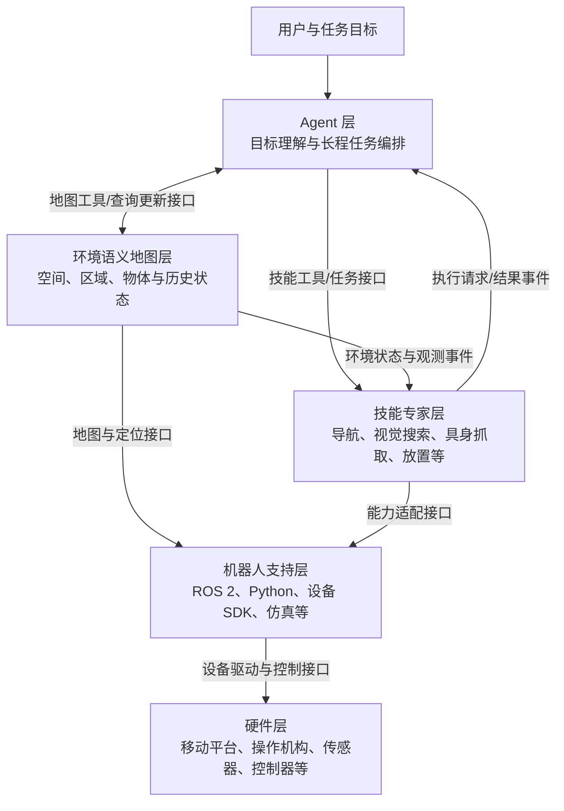

# Agent驱动的可扩展具身移动操作机器人

> 以家居环境为主要应用和验证场景，构建可扩展的移动操作机器人系统。

## 一、设计目标

本项目面向需要在真实环境中完成移动、感知和操作的机器人系统，目标是将现有的导航、视觉感知、具身模型、运动规划和 Agent 技术组织成职责清晰、接口稳定、便于替换和扩展的系统骨架。项目以家居环境为主要应用背景和第一阶段验证场景，房间、物体、任务和技能均采用可配置、可替换的表示。

项目重点是系统组织、任务编排、环境状态管理和仿真到真实的工程化验证，不以训练新的具身基础模型或重新研究成熟的底层算法为主要目标。

## 二、总体分层架构



系统由五个主要功能层组成，胶水机制不作为独立功能层，而是贯穿各层之间和层内封装的接口、适配与运行机制。Agent 负责理解目标和组织任务，环境语义地图提供环境状态，技能专家执行具体能力，支持层连接机器人软件与计算生态，硬件层承担真实设备和实时控制。胶水机制通过工具、服务、消息和事件接口把这些能力组织起来，并处理异步任务、状态转换和事件传递。

## 三、各层职责

### 1. Agent 层

Agent 是系统的任务编排中心，负责理解自然语言目标，查询环境语义地图，拆解长程任务，调用导航、视觉搜索和具身抓取等技能，并根据完成、失败、超时和环境变化调整计划。Agent 维护任务上下文和必要的机器人记忆，但不直接承担电机级控制、实时闭环和安全保护。项目暂定以 Pi Agent 作为引擎候选，通过工具和事件接口接入，避免绑定某一实现。

### 2. 环境语义地图层

环境语义地图是机器人侧的空间与物体状态管理模块，用于连接感知结果、任务规划和技能执行。它不等同于具身模型中的“世界模型”，也不要求从零研究新的 SLAM 或开放词汇建图算法。

- **几何地图**：依托成熟 SLAM 得到 2D 栅格地图或 3D 点云/网格，提供定位、可通行区域和导航目标表达；
- **物体语义与概率性实例关联**：记录物体类别、实例特征、最近观测位置、时间和置信度，根据历史观测和当前感知结果推断候选位置及实例关联概率；
- **区域语义**：支持用户标记房间或区域用途，初期可通过配置文件或 JSON 保存，后续再扩展自动感知。

例如，系统可以向 Agent 返回：“目标水杯最可能在客厅桌面，其次在厨房；客厅桌面候选置信度为 0.78。”地图提供查询、观测记录、状态更新和历史追踪接口。通过地图层的接口适配和工具封装，这些能力可以被 Agent 方便地调用，并可在用户侧图形化显示候选位置及置信度。

### 3. 技能专家层

技能专家是可被 Agent 调用的具体机器人能力。具身模型、传统运动规划器、视觉模型或多个算法组成的服务，都可以通过统一接口成为技能专家。第一阶段重点考虑导航、视觉搜索、具身抓取入篮和返回用户附近。技能专家应描述输入、输出、前置条件、状态、取消方式和失败原因，避免 Agent 依赖某个模型的私有接口。

### 4. 机器人支持层

机器人支持层由 ROS 2、Python 等语言和工具生态、设备 SDK、仿真框架及其他基础软件组成，提供定位、导航、TF 坐标关系、传感器数据、设备驱动、运动规划、模型推理和仿真接口等基础能力，负责连接技能专家与底层硬件，但不负责理解用户的长程目标。

### 5. 硬件层

硬件层包括机械结构、移动平台、操作机构、传感器、执行器、计算设备、通信设备、高实时控制器及其他机器人硬件。底层控制器负责电机位置、速度、力矩等实时控制及相关安全功能；上层通过机器人中间件、厂商 SDK 或专用接口使用这些能力。

## 四、层间胶水机制与事件驱动运行时

胶水机制不是单独限制在某一层或某一种通信协议中的模块，而是分布在层间连接、层内封装和工具适配中的一组机制。它负责把环境语义地图封装为 Agent 可查询和更新的工具，把技能专家封装为可调用能力，也负责连接 Agent、地图、技能、支持层和硬件之间的服务接口。

由于各部分可能运行在不同进程或设备上，胶水机制还需要处理接口适配、任务提交/查询/取消、超时管理、技能状态统一表达，以及任务完成、失败、环境变化和用户新指令等事件传递。第一版可采用 HTTP/JSON 控制面、SSE 或 WebSocket 进度推送，并结合 ROS 2、Python 服务和设备 SDK；具体协议根据原型验证结果确定。

典型流程：

```text
用户提出“找到水杯并带回来”
  → Agent 通过地图工具查询环境语义地图并选择候选区域
  → 导航与视觉搜索技能执行并返回事件
  → Agent 根据结果继续搜索、调整计划或请求帮助
  → 具身抓取技能将目标放入篮子
  → 导航返回用户附近
  → Agent 汇总结果，地图记录新的物体状态
```

## 五、第一阶段验证与扩展原则

第一阶段以有限物品集合和受控室内环境验证完整闭环，重点观察语义地图是否提供有效候选位置、Agent 是否能根据事件推进任务、技能专家是否能协同完成移动与操作，以及接口是否允许替换物品、区域或技能实现。垃圾处理、拖鞋归位、收纳和更复杂任务可在相同架构上增加新的技能专家和任务流程，硬件也可在不改变上层接口的前提下升级。

## 六、设计原则

1. **职责分离**：Agent 负责任务组织，技能专家负责能力执行，ROS 2 和硬件负责确定性运行与实时控制。
2. **接口优先**：上层使用稳定的能力和地图接口，不直接依赖具体模型、算法或设备。
3. **事件驱动**：长程任务由技能结果、环境变化和用户指令共同推动。
4. **概率表达**：对物体位置和实例身份保留置信度与候选集合。
5. **仿真先行**：先用轻量仿真验证流程和接口，再逐步接入真实设备。
6. **面向扩展**：家庭物品寻找与取回是首个验证场景，数据模型和技能接口不绑定单一房间、物品集合或任务流程。
