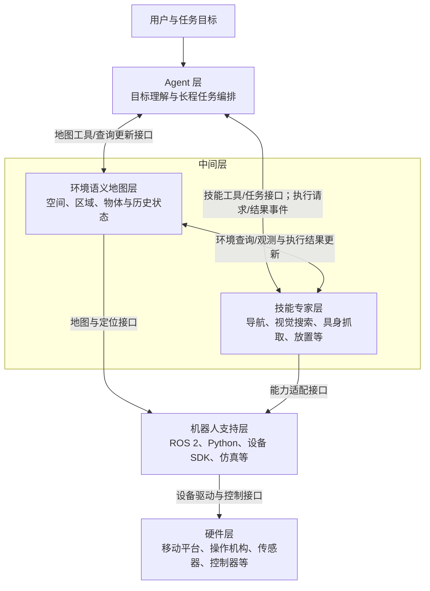

# Agent 驱动的可扩展具身家居机器人

本架构从通用机器人应用需求出发，利用现代 Agent 支撑机器人围绕不同用户目标组织任务，根据环境与执行反馈持续调整行动，并通过清晰的接口、适配和调优流程，使新技能更容易接入、组合和复用。任务组织不围绕单一类别设计，具体执行由可用技能、环境和平台条件共同支撑。

## 一、总体分层架构



系统由五个主要功能层组成。胶水机制不作为独立功能层，而是贯穿各层之间和层内封装的接口、适配与运行机制。

- **Agent 层**：理解用户指令、组织长程任务、查询地图、调用技能并根据事件调整计划；不承担电机级控制和实时安全闭环。
- **环境语义地图层**：在统一环境认知服务中维护空间、区域、物体、观测历史及相关不确定状态，为任务决策提供查询与更新接口；概率性实例关联和位置推断是该系统内相互关联的状态估计问题。
- **技能专家层**：封装导航、视觉搜索、具身操作、运动规划等可被 Agent 调用的机器人能力。
- **机器人支持层**：连接 ROS 2、设备 SDK、仿真框架、传感器、定位、导航和运动规划等基础能力。
- **硬件层**：提供移动平台、操作机构、传感器、执行器、计算设备和实时控制器。

## 二、层间接口与运行机制

### 1. Agent 与环境语义地图

Agent 通过地图工具或服务查询环境状态、物体候选位置和历史信息，并提交观测结果、任务结果和状态变化。地图层向 Agent 返回结构化状态和置信信息，不要求 Agent 直接访问底层感知或地图数据库。

### 2. Agent 与技能专家

Agent 通过统一的技能接口提交任务。技能接口应描述输入、输出、前置条件、执行状态、取消方式和失败原因，使 Agent 不依赖具体模型、算法或设备的私有接口。

技能专家从可承担的任务与能力出发抽象，向 Agent 提供用途、输入输出、适用条件、执行状态和结果等信息，具体模型与算法的执行过程由技能内部承担。具身模型、传统运动规划器、视觉模型、确定性程序或多个模块组成的服务，都可以作为技能专家接入；封装粒度根据任务能力与调用需要确定。

### 3. 地图、技能与机器人支持层

技能可查询环境认知服务，并提交观测及经过确认的执行结果，由环境服务维护和更新状态。

地图层通过定位、地图和环境状态接口使用机器人支持能力；技能层通过能力适配接口使用导航、传感器、运动规划、模型推理和设备控制能力。机器人支持层负责连接软件能力与硬件，不负责理解用户的长程目标。

### 4. 任务与事件

系统采用任务请求和事件反馈相结合的运行方式。技能执行过程中产生进行中、完成、失败、超时、取消和环境变化等状态，Agent 根据这些事件继续执行、调整计划或终止任务。用户的新指令也作为任务事件进入运行时。

胶水机制负责工具封装、接口适配、任务提交与查询、取消和超时管理、状态统一表达以及事件传递。具体通信协议在后续专项设计中确定。

## 三、架构设计原则

1. **职责分离**：Agent 负责任务组织，技能专家负责能力执行，支持层和硬件负责确定性运行与实时控制。
2. **接口优先**：上层依赖稳定的能力接口和地图接口，不直接依赖具体模型、算法或设备。
3. **事件驱动**：长程任务由技能结果、环境变化和用户指令共同推动。
4. **模块可替换**：仿真模块、真实模块、技能实现和硬件适配器可以在接口层替换。
5. **面向扩展**：新增技能、任务类型或硬件时，尽量不修改 Agent 的核心任务组织逻辑。

## 四、典型运行关系

```text
用户目标
  → Agent 理解目标并查询环境语义地图
  → Agent 选择并调用一个或多个技能专家
  → 技能专家通过机器人支持层使用导航、感知和操作能力
  → 技能返回结果或事件
  → Agent 根据结果继续、调整或结束任务
  → 地图层记录新的观测和任务状态
```

本文件只描述系统架构及其运行关系。项目目标、语义地图数据模型、验证任务和通信协议分别在其他文件中维护。
